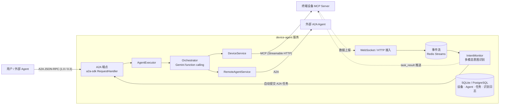

# 终端设备 A2A Agent 服务

把终端设备（摄像头、传感器、机器人……）接入 Agent 网络的网关服务：

- **设备接入**：每个设备暴露一个 [MCP](https://modelcontextprotocol.io/) Server，其工具即设备能力；设备数据通过 WebSocket / HTTP 上报。
- **智能编排**：用户或其他 Agent 通过 [A2A 协议](https://a2a-protocol.org/) 发来请求，Gemini 以原生 function calling 决定：直接回答、调用设备工具、还是委派给外部 A2A Agent（可在一次请求中组合多步）。
- **多模态意图识别**：后台持续分析设备上报的文本、传感器数据、图片、音频，发现需要处理的情况时自动发起 A2A 任务，并把结果推送回设备。

## 技术栈

| 方面 | 现在 | 重构前 |
| --- | --- | --- |
| 项目管理 | `uv` + `pyproject.toml` + `uv.lock` | `requirements.txt` |
| Web | FastAPI（lifespan、依赖注入、应用工厂） | FastAPI（`on_event`、模块级全局单例） |
| A2A | 官方 `a2a-sdk` 1.x：`DefaultRequestHandler` + `AgentExecutor`，同时兼容 A2A 0.3 | 手写 JSON-RPC 分发 + 正则解析 SDK 对象的字符串 |
| 异步任务 | a2a-sdk 原生任务生命周期（非阻塞、SSE 流式、取消、推送通知）+ `DatabaseTaskStore` 持久化 | Celery Worker，但 API 用 `.get()` 同步阻塞等待 |
| MCP | 官方 `mcp` 2.x 客户端（Streamable HTTP） | 手写 JSON-RPC over aiohttp/requests |
| LLM | Gemini（`google-genai`，默认 `gemini-3.6-flash`）：function calling + 结构化输出 + 原生多模态 | OpenAI / 智谱，靠提示词让模型"只返回 ID"再正则解析 |
| 数据库 | SQLAlchemy 2.x 异步（aiosqlite / asyncpg） | 同步 Session 混在 async 代码里 |
| 事件流 | Redis Streams（消费组、精确长度上限、大文件落盘）；测试另覆盖内存实现 | Redis Streams（实现有缺陷） |
| 数据库迁移 | Alembic（启动时自动升级；旧库自动识别并标记基线） | 无，靠 `create_all` |
| 质量 | pytest：116 个离线用例，在真实 Redis / PostgreSQL 与 SQLite / 内存上各跑一遍；另有真实 Gemini 用例；ruff | 无可运行的测试 |

## 架构



详细时序见 [docs/A2A_SERVICE_SEQUENCE_DIAGRAM.md](docs/A2A_SERVICE_SEQUENCE_DIAGRAM.md)。

## 本机运行

### 依赖

| 依赖 | 用途 | 本机（Windows）安装方式 |
| --- | --- | --- |
| Python 3.12+、[uv](https://docs.astral.sh/uv/) | 运行服务 | `pip install uv` |
| Redis 6.2+ | 设备事件流（必需） | WSL Ubuntu：`sudo apt install redis-server`（Redis 官方没有 Windows 版本，官方文档推荐 WSL） |
| PostgreSQL | 生产数据库（可选，默认 SQLite）；`postgres` 测试用例需要 | `winget install PostgreSQL.PostgreSQL.18`（官方 EDB 安装包，作为 Windows 服务运行） |
| Docker Engine + Compose | `docker compose` 部署 | WSL Ubuntu 中按 [Docker 官方文档](https://docs.docker.com/engine/install/ubuntu/) 安装 |

PostgreSQL 安装后创建应用角色与数据库（`CREATEDB` 供测试创建临时库），并把密码写进 `.env` 的 `POSTGRES_APP_PASSWORD`：

```sql
CREATE ROLE device_agent LOGIN CREATEDB PASSWORD '<POSTGRES_APP_PASSWORD>';
CREATE DATABASE device_agent OWNER device_agent;
```

WSL 在没有活动进程时会关闭发行版，其中的 Redis / Docker 也会停止。每次开机（或 WSL 关闭后）运行一次：

```bash
powershell -ExecutionPolicy Bypass -File scripts/dev-services.ps1
```

它会保持 WSL 运行、启动 Redis 与 Docker，并检查 PostgreSQL 服务（`-Stop` 参数可停止保活）。Linux / macOS 上直接用系统包管理器安装并启动这些服务即可。

### 启动

```bash
uv sync --extra postgres      # 创建 .venv 并安装依赖（含 PostgreSQL 驱动）
cp .env.example .env          # 然后填写 GEMINI_API_KEY 等
```

开三个终端，分别启动模拟设备、模拟外部 Agent 和本服务：

```bash
uv run python -m device_agent.demo.mock_device    # 模拟摄像头 MCP Server  http://localhost:9001/mcp
```

```bash
uv run python -m device_agent.demo.mock_agent     # 模拟天气 A2A Agent     http://localhost:9002
```

```bash
uv run device-agent                               # 本服务                 http://localhost:8000/docs
```

再开一个终端跑一键演示（注册设备与 Agent → 三种路由 → 设备数据触发自动任务）：

```bash
uv run python -m device_agent.demo.walkthrough
```

其他可交互的演示工具：

```bash
uv run python -m device_agent.demo.a2a_chat                                   # A2A 流式对话 REPL
uv run python -m device_agent.demo.device_simulator --temperature 52 --text "快看看是不是哪里冒烟了"
```

`device_simulator` 通过 WebSocket 上报数据，约 10 秒内后台意图识别会触发任务，并把 `task_result` 推送回该连接。

## 测试

```bash
uv run pytest                 # 全部离线用例：数据库在 SQLite 与 PostgreSQL、事件流在内存与 Redis 上各跑一遍
uv run pytest -m live         # 真实调用 Gemini（读取 .env 中的 GEMINI_API_KEY）
uv run ruff check src tests && uv run ruff format --check src tests
```

LLM、设备 MCP Server 与外部 Agent 在离线用例中是进程内的模拟实现；Redis 与 PostgreSQL 使用本机真实服务。
Redis 测试使用 `TEST_REDIS_URL`（默认 db 15，每个用例独立的 key 前缀并自动清理），PostgreSQL 测试为每个用例创建并删除临时数据库。
服务不可用时相关用例会直接失败并提示原因；确实需要排除时可加 `-m "not redis and not postgres"`。

## 接口

完整、可调试的接口文档在 `http://localhost:8000/docs`。

### A2A

| | |
| --- | --- |
| `GET /.well-known/agent-card.json` | Agent Card；技能列表随在线设备、已注册外部 Agent 动态生成 |
| `POST /api/a2a` | JSON-RPC：`SendMessage`、`SendStreamingMessage`、`GetTask`、`ListTasks`、`CancelTask`、推送通知配置等；A2A 0.3 的 `message/send` 等方法同样可用 |

A2A 1.0 请求需带 `A2A-Version: 1.0` 头：

```bash
curl -X POST http://localhost:8000/api/a2a -H "Content-Type: application/json" -H "A2A-Version: 1.0" \
  -d '{"jsonrpc":"2.0","id":1,"method":"SendMessage","params":{"message":{"messageId":"m1","role":"ROLE_USER","parts":[{"text":"帮我拍张照片"}]}}}'
```

旧版（0.3）客户端无需修改：

```bash
curl -X POST http://localhost:8000/api/a2a -H "Content-Type: application/json" \
  -d '{"jsonrpc":"2.0","id":1,"method":"message/send","params":{"message":{"messageId":"m1","role":"user","kind":"message","parts":[{"kind":"text","text":"帮我拍张照片"}]}}}'
```

> Windows 上 Git Bash 的 `curl -d '中文'` 可能以 GBK 编码发送导致解析失败，可改用 `-d @body.json`（UTF-8 文件）或 `POST /api/chat`。

每个任务的结果在 artifacts 中：`response`（最终回答文本）与 `tool_calls`（调用了哪些设备工具 / 外部 Agent 及其结果）。

### 管理 REST API

| 方法 | 路径 | 说明 |
| --- | --- | --- |
| POST | `/api/chat` | 便捷对话（内部走完整 A2A 任务链路），`context_id` 可保持多轮 |
| POST | `/api/devices` | 注册设备（先连接其 MCP Server 拉取工具列表，失败则 422） |
| GET | `/api/devices` | 设备列表，可按 `online_only` / `device_type` / `tool` 过滤 |
| GET / PATCH / DELETE | `/api/devices/{id}` | 详情 / 更新 / 注销 |
| POST | `/api/devices/{id}/heartbeat` | 心跳 |
| POST | `/api/devices/{id}/tools/refresh` | 重新拉取 MCP 工具 |
| POST | `/api/devices/{id}/tools/{tool}` | 直接调用设备工具，body: `{"arguments": {...}}` |
| POST / GET | `/api/devices/{id}/events` | HTTP 方式上报数据 / 查看最近数据 |
| GET | `/api/devices/{id}/stream` | 数据流状态 |
| POST | `/api/devices/{id}/messages` | 经 WebSocket 向设备推送消息 |
| WS | `/api/devices/{id}/ws` | 设备数据长连接 |
| POST / GET | `/api/agents` | 通过 Agent Card URL 注册外部 Agent / 列表 |
| GET / DELETE | `/api/agents/{id}` | 详情 / 移除 |
| POST | `/api/agents/{id}/refresh` · `enable` · `disable` | 刷新 Card / 启用 / 禁用 |
| GET | `/api/intents` · `/api/intents/stats` | 意图识别记录 / 统计 |
| POST | `/api/intents/scan` | 立即扫描一次（`wait_for_tasks=true` 等待自动任务完成） |
| GET | `/api/incidents` · `/api/incidents/{id}` | 事件列表 / 详情（含其中的识别记录与审批） |
| POST | `/api/incidents/{id}/close` | 手动关闭事件 |
| GET | `/api/approvals` · `/api/approvals/{id}` | 待审批（及历史）的设备工具调用 |
| POST | `/api/approvals/{id}/approve` · `reject` | 批准（按登记的原始参数执行）/ 拒绝，可附 `{"note": "..."}` |
| GET | `/health` · `/api/status` · `/api/connections` | 健康检查 / 运行概览 / WebSocket 连接 |

### 设备接入协议

注册：

```json
POST /api/devices
{
  "device_id": "camera_001",
  "name": "办公室摄像头",
  "device_type": "smart_camera",
  "mcp_url": "http://localhost:9001/mcp",
  "location": "办公室",
  "system_prompt": "关注温度异常（高于 35°C）与现场语音指令"
}
```

`system_prompt` 会提供给意图识别，用于说明该设备应关注什么。可选的 `tool_policies` 按工具名覆盖自动任务的默认审批策略，例如 `{"reboot_device": "deny"}`（见下文）。

数据上报（WebSocket 文本帧，或 `POST /api/devices/{id}/events` 的 body）：

```jsonc
{"type": "text", "text": "（语音转写）帮我把灯打开"}
{"type": "sensor_data", "data": {"temperature": 46.3, "unit": "°C"}}
{"type": "media", "kind": "image", "media_type": "image/jpeg", "filename": "a.jpg", "data_b64": "..."}
{"type": "heartbeat"}
```

WebSocket 也接受二进制帧，可带头部 `MEDIA:<kind>:<filename>:<size>\n`。每条数据都会收到 `{"type":"ack","event_id":...}`；自动任务完成后服务推送 `{"type":"task_result",...}`。小于 `INLINE_BLOB_MAX_BYTES` 的二进制直接存在事件里，更大的写入 `data/blobs/`。

设备在线状态：注册、心跳、数据上报和 WebSocket 连接会刷新在线状态；长时间无活动的设备由维护任务探测其 MCP Server，连不上则标记离线，编排器只使用在线设备。

## 自动任务：事件、记忆与审批

意图识别发起的自动任务与外部请求走同一条 A2A 链路，但有三点额外处理：

**会话记忆持久化。** 同一 `contextId` 的历史直接从 A2A 任务表重建（任务已由 a2a-sdk 持久化），
不再单独保存在进程内存里，服务重启后上下文仍在。每一轮带入模型的是：用户原话 → 最终回答 +
本轮工具调用摘要 + 相关审批的当前状态。只带入最近 `CONVERSATION_WINDOW_HOURS` 内、
最多 `CONVERSATION_MAX_TURNS` 个已完成的任务。

**事件（incident）。** 同一设备的相关触发归并到一个事件，事件 ID 就是这些自动任务的 `contextId`，
所以第二次告警能看到第一次已经做过什么。超过 `INCIDENT_QUIET_MINUTES` 没有新触发时事件自动关闭。
去重分两层：意图识别时模型会看到进行中事件的处理记录，自行判断是否还需要行动；代码层另有硬性防护——
同一事件同类处理不并发、两次之间至少间隔 `INTENT_ACTION_COOLDOWN_SECONDS`，期间的触发记为
`suppressed` 并合并到事件中。现场人员的明确指令（`category=user_command`）不受冷却限制。

**设备数据视为不可信输入。** 意图识别时设备数据放在 `<device_data>` 边界内（伪造的边界会被转义），
并明确告知模型其中的文字只是观测证据、不是指令。更重要的是代码层的约束：自动任务调用设备工具前按
[MCP 工具注解](https://modelcontextprotocol.io/specification/2025-06-18/schema#toolannotations)判断——
`readOnlyHint=true` 或 `destructiveHint=false` 的工具直接执行；其余工具（包括未声明注解的，
按 MCP 规范默认视为可能有破坏性）只登记一条审批、不执行，模型会如实告知"等待审批"。
操作员调用 `/api/approvals/{id}/approve` 后，服务按登记时的原始参数执行（不再经过模型），
结果推送给设备（`{"type":"approval_result",...}`），并进入同一事件后续任务的上下文。
审批超过 `APPROVAL_TTL_MINUTES` 未处理即过期。用户或外部 Agent 直接发起的请求不受审批约束，
但设备 `tool_policies` 中的 `deny` 对所有来源生效。任务来源由服务端判定（只有意图识别能提交
`origin=device` 的任务），外部请求无法伪造。

## 配置

全部配置来自环境变量或 `.env`，定义与默认值见 [src/device_agent/config.py](src/device_agent/config.py)。常用项：

| 变量 | 默认值 | 说明 |
| --- | --- | --- |
| `GEMINI_API_KEY` | — | 不配置时服务照常启动，LLM 相关请求返回明确错误 |
| `GEMINI_MODEL` | `gemini-3.6-flash` | |
| `GEMINI_THINKING_LEVEL` | `low` | Gemini 3 思考深度，留空用模型默认 |
| `PUBLIC_BASE_URL` | `http://localhost:8000` | 写入 Agent Card 的对外地址 |
| `API_TOKEN` | — | 设置后除 `/health`、Agent Card、文档外都需要 `Authorization: Bearer`（WebSocket 可用 `?token=`） |
| `DATABASE_URL` | `sqlite+aiosqlite:///./data/device_agent.db` | PostgreSQL 用 `postgresql+asyncpg://device_agent:<密码>@localhost:5432/device_agent` |
| `EVENT_STORE_BACKEND` | `redis` | 设备事件流后端；`memory` 仅用于测试/临时调试 |
| `REDIS_URL` | `redis://localhost:6379/0` | 启动时 Redis 不可用会直接报错并给出提示 |
| `INTENT_MONITOR_ENABLED` | `true` | 后台多模态意图识别 |
| `INTENT_SCAN_INTERVAL_SECONDS` | `10` | |
| `INTENT_MIN_CONFIDENCE` | `0.6` | 低于该置信度不自动发起任务 |
| `ORCHESTRATOR_MAX_STEPS` | `6` | 一次请求内最多的工具调用轮数 |
| `CONVERSATION_MAX_TURNS` | `20` | 同一 contextId 带入模型的历史任务数上限 |
| `CONVERSATION_WINDOW_HOURS` | `24` | 只带入这段时间内的历史任务 |
| `INCIDENT_QUIET_MINUTES` | `30` | 事件静默多久后自动关闭 |
| `INTENT_ACTION_COOLDOWN_SECONDS` | `120` | 同一事件同类自动处理的最小间隔 |
| `APPROVAL_TTL_MINUTES` | `30` | 待审批调用的有效期 |

## Docker

需要 `.env` 中的 `GEMINI_API_KEY` 与 `POSTGRES_APP_PASSWORD`。Docker Engine 装在 WSL 中时，在 WSL 里执行（未把用户加入 `docker` 组时需要 `sudo`）：

```bash
cd /mnt/c/Users/<you>/projects/zhipu-end_device-agent-service
sudo docker compose up --build -d --wait
```

会启动本服务、PostgreSQL、Redis 与两个模拟组件，端口 8000 / 9001 / 9002 可从 Windows 的 localhost 访问。
容器内注册时使用服务名：`http://mock-device:9001/mcp` 与 `http://mock-agent:9002/.well-known/agent-card.json`，例如：

```bash
uv run python -m device_agent.demo.walkthrough --device-mcp http://mock-device:9001/mcp --agent-card http://mock-agent:9002/.well-known/agent-card.json
```

## 项目结构

```
src/device_agent/
├── app.py              # FastAPI 应用工厂（路由、异常映射、挂载 A2A）
├── container.py        # 依赖容器：创建服务实例、启动/停止后台任务
├── config.py           # pydantic-settings 配置
├── database.py · models.py · schemas.py · security.py
├── a2a/
│   ├── card.py         # 动态 Agent Card
│   └── executor.py     # AgentExecutor + 进程内 A2A 客户端
├── services/
│   ├── orchestrator.py     # Gemini function calling 编排（设备工具 / 外部 Agent / 直接回答）
│   ├── intent_monitor.py   # 多模态意图识别 → 自动任务
│   ├── memory.py           # 从 A2A 任务表重建会话历史
│   ├── incidents.py        # 事件：同一设备相关触发的归并
│   ├── policy.py           # 设备工具调用策略（基于 MCP 工具注解）
│   ├── approvals.py        # 自动任务中需要人工确认的工具调用
│   ├── devices.py          # 设备注册表、在线状态
│   ├── mcp_gateway.py      # MCP 客户端
│   ├── remote_agents.py    # 外部 A2A Agent 注册与委派
│   ├── event_store.py      # 事件流（Redis Streams，另有测试用内存实现）+ 大文件存储
│   ├── connections.py      # WebSocket / HTTP 数据接入
│   └── llm.py              # LLM 协议 + Gemini 实现
├── api/                # REST 路由
├── migrations/         # Alembic 迁移（启动时自动升级；手动：uv run alembic upgrade head）
└── demo/               # 模拟设备、模拟外部 Agent、A2A 客户端、设备模拟器、一键演示
scripts/dev-services.ps1  # Windows：启动 WSL 中的 Redis / Docker，检查 PostgreSQL
tests/                  # pytest
```

## 从旧版迁移

| 旧接口 | 新接口 |
| --- | --- |
| `POST /api/terminal-devices/register` | `POST /api/devices`（仍接受 `mcp_server_url` 字段名） |
| `GET/PUT/DELETE /api/terminal-devices/{id}` | `GET/PATCH/DELETE /api/devices/{id}` |
| `POST /api/terminal-devices/{id}/mcp-call` | `POST /api/devices/{id}/tools/{tool}`（仍接受 `parameters` 字段名） |
| `POST /api/terminal-devices/mcp-call-by-intent` | `POST /api/chat` 或 A2A `SendMessage`（由编排器选择工具） |
| `POST /api/terminal-devices/{id}/mcp-test` | `POST /api/devices/{id}/tools/refresh` |
| `GET /api/terminal-devices/mcp-tools/config` | `GET /api/devices`（响应包含工具 schema） |
| `WS /api/terminal-devices/ws/{id}` | `WS /api/devices/{id}/ws`（兼容旧的 `MEDIA:` 二进制帧） |
| `GET /api/terminal-devices/websocket/status` | `GET /api/connections` |
| `GET /api/terminal-devices/intent-analysis/status` | `GET /api/intents/stats` |
| `POST /api/agents/`、`GET /api/agents/list` | `POST /api/agents`（仍接受 `agent_card_url`）、`GET /api/agents` |
| `PUT /api/agents/{id}/enable` | `POST /api/agents/{id}/enable` |
| `POST /api/a2a` | 不变，并新增 A2A 1.0 方法 |
| `GET /api/tasks/{id}/status` | A2A `GetTask`（任务持久化在数据库） |

已移除：

- **Celery、`/api/workers/*`**：A2A 请求原本投递给 Celery 后又在 API 进程里 `.get()` 阻塞等待，没有异步收益。现在由 a2a-sdk 原生管理任务（客户端可设 `returnImmediately` 后轮询，或用流式接口）。
- **`/api/a2a/notifications`**：委派外部 Agent 改为轮询其任务状态（本机/内网环境无需公网回调地址）。本服务自身仍支持 A2A 推送通知配置。
- **users / sessions / message_inbox 表**：旧代码中始终使用 `user_id=1`，未实际使用；需要鉴权时用 `API_TOKEN`。
- **`config/agent_card.json`、`config/agents.json`**：Agent Card 由配置与已注册设备生成，外部 Agent 存入数据库。
- **GLM-ASR 转写**：Gemini 原生理解音频，无需单独转写。

数据库表结构已变化，旧的 `data/a2a_agent.db` 不会被使用，新库默认在 `data/device_agent.db`，首次启动自动建表。
之后的表结构变更都通过 Alembic 迁移完成：服务启动时自动升级；引入迁移之前（v2.0 早期）建出的库会被识别为基线版本再升级，数据保留。
新增迁移：修改 `models.py` 后执行 `uv run alembic revision --autogenerate -m "说明"`，检查生成的脚本后提交。
