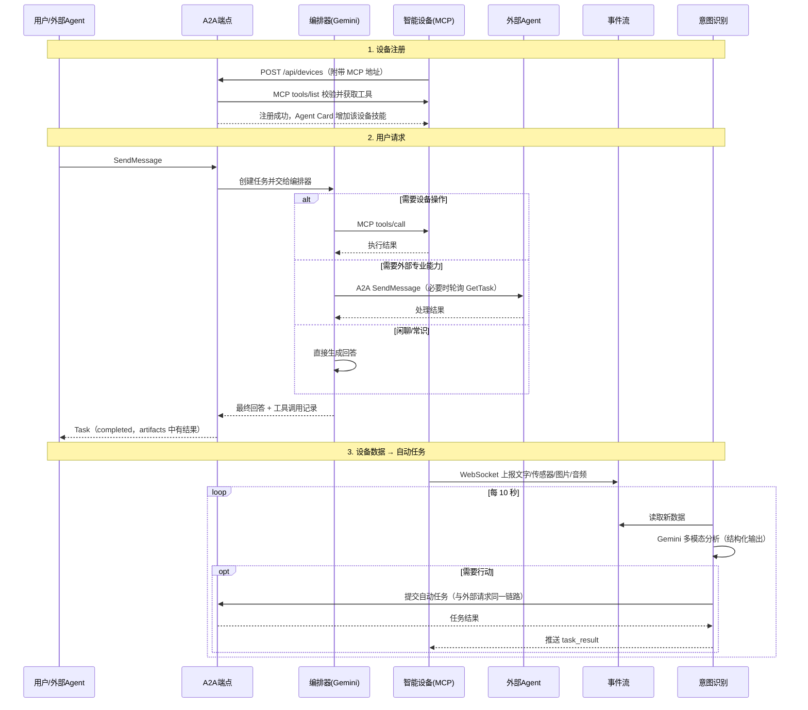
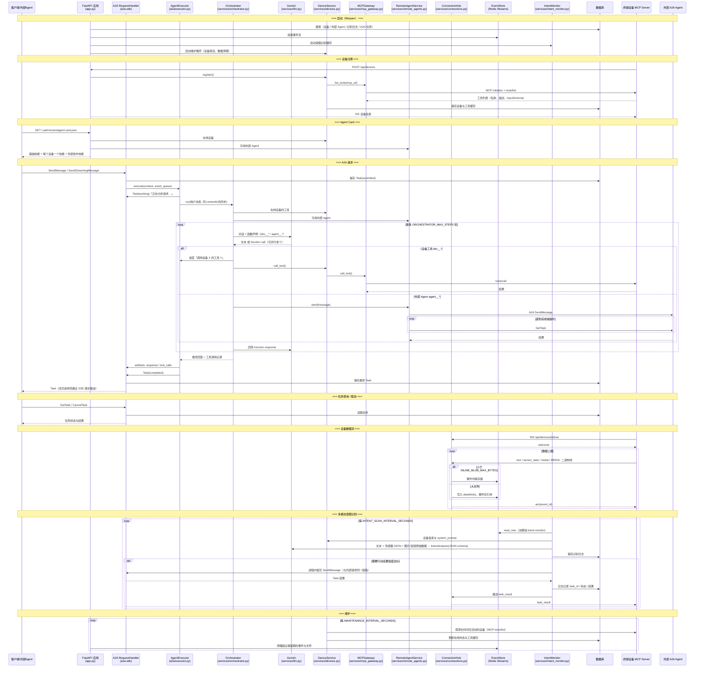
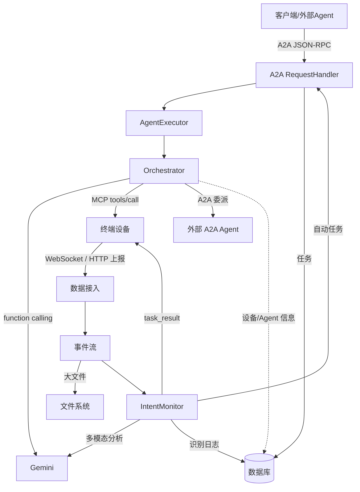

# A2A终端设备代理服务 - 详细时序图

## 服务讲解稿 - 面向技术新手

### 什么是A2A终端设备代理服务？

大家好，今天我要为大家介绍一个智能的**A2A终端设备代理服务**。

**首先，让我们理解几个核心概念：**

#### 1. 什么是A2A协议？
- **A2A** = Agent-to-Agent（代理到代理）
- 这是一个标准的通信协议，让不同的AI代理之间可以互相对话和协作
- 就像人与人之间有语言交流，AI代理之间也需要一套"语言"来沟通

#### 2. 什么是终端设备？
- 指各种智能设备：摄像头、传感器、机器人、IoT设备等
- 这些设备有自己的功能（拍照、测温、移动等），但需要"大脑"来协调

#### 3. 我们的服务做什么？
我们的服务就是这个"大脑"，它的作用是：
- **连接** 各种智能设备
- **理解** 用户的需求
- **智能分派** 任务给合适的设备
- **协调** 多个设备协同工作

### 核心功能解析

#### 功能1：设备管理 - "设备户口本"
```
想象一下：
- 每个智能设备来到我们系统，都要先"登记注册"
- 系统会记录：这个设备叫什么名字？能做什么？怎么联系它？
- 就像给每个设备建立一个"身份档案"
```

#### 功能2：智能意图识别 - "AI秘书"
```
当用户说："帮我拍张照片"
系统会思考：
1. 用户想要什么？ → 拍照
2. 哪个设备能做？ → 摄像头设备
3. 怎么执行？ → 调用摄像头的拍照功能
```

#### 功能3：任务协调 - "交通指挥员"
```
复杂任务例子："监控办公室安全"
系统会协调：
- 摄像头：负责拍摄画面
- 传感器：检测异常
- 报警器：发现问题时报警
- 所有设备配合完成一个大任务
```

#### 功能4：数据流管理 - "智能仓库"
```
设备会产生大量数据：
- 文本数据：传感器读数
- 图片数据：摄像头照片  
- 文件数据：设备日志
系统像仓库管理员，分类存储这些数据
```

### 系统如何工作？ - 用生活化类比

#### 类比1：智能家居管家系统
```
把我们的服务想象成一个超级智能的家居管家：

1. 设备注册 = 新家电入住登记
   - 新买的智能音箱、扫地机器人要先"报到"
   - 管家记录：它们在哪个房间、有什么功能

2. 用户请求 = 主人下达指令
   - 主人说："我要听音乐" 
   - 管家理解并找到音箱执行

3. 智能协调 = 多设备配合
   - 主人说："我要休息了"
   - 管家协调：关灯、调温度、播放轻音乐
```

#### 类比2：企业办公系统
```
我们的服务就像一个企业的智能助理：

1. 员工管理 = 设备管理
   - 每个员工（设备）有自己的技能
   - 系统知道谁会什么，在哪个部门

2. 任务分派 = 智能路由
   - 老板（用户）说要做个项目
   - 助理分析需要哪些技能，派给合适的员工

3. 进度跟踪 = 任务状态管理
   - 实时了解每个任务的完成情况
```

### 技术架构 - 分层理解

#### 第1层：接入层（前台接待）
- **A2A 端点**（官方 a2a-sdk）：接待其他 Agent 和用户，说标准的 A2A"语言"（同时兼容 1.0 与 0.3 两个版本）
- **管理 REST API / WebSocket**：设备注册、数据上报、运维查询
- **鉴权中间件**：可选的 Bearer Token，确保安全

#### 第2层：智能层（大脑）
- **编排器 Orchestrator**：Gemini 的"函数调用"能力把每个设备工具、每个外部 Agent 都当成一个可调用的函数，由模型自己决定直接回答、调用设备还是委派外部 Agent，并能一次组合多个步骤
- **意图识别监控 IntentMonitor**：持续"看"设备上报的文字、传感器读数、图片和声音，发现需要处理的情况就主动发起任务

#### 第3层：能力层（各部门）
- **设备服务**：设备户口本 + 通过 MCP 协议操作设备
- **外部 Agent 服务**：外部专家通讯录 + 通过 A2A 协议委派任务
- **数据接入**：把设备上报的数据整理后放进事件流

#### 第4层：数据存储层（档案室和仓库）
- **数据库**（SQLite / PostgreSQL）：设备信息、外部 Agent、A2A 任务、意图识别日志
- **事件流**（Redis Streams）：设备实时数据；大文件单独放在文件系统

> 重构前的"异步任务队列 + Worker 进程"（Celery）已经移除：a2a-sdk 本身就能以非阻塞方式管理任务，
> 客户端提交后可以立即拿到任务 ID，再查询或订阅进度。

### 实际工作流程演示

#### 场景：办公室智能监控
```
第1步：设备准备
- 办公室安装了3个摄像头
- 每个摄像头都注册到我们的系统
- 系统记录：位置、功能、联系方式

第2步：用户需求
- 用户通过API发送：「监控办公室，发现异常立即通知」

第3步：系统分析
- LLM分析：用户要做安全监控
- 查找设备：找到3个摄像头都有监控能力
- 制定计划：启动所有摄像头，开启异常检测

第4步：任务执行
- 分别给3个摄像头发送指令
- 摄像头开始实时拍摄和分析
- 数据流实时传输到系统

第5步：智能处理
- 系统实时分析视频流
- AI检测是否有异常情况
- 发现问题自动发送通知

第6步：结果反馈
- 用户可以随时查询监控状态
- 收到异常报警时获得详细信息
```

### 核心优势

#### 1. 异步处理 - "多线程工作"
- 不会因为一个任务卡住而影响其他任务
- 就像办公室有多个员工同时工作

#### 2. 智能路由 - "最佳人选"
- 根据任务特点选择最合适的设备
- 就像项目经理选择最合适的团队成员

#### 3. 自动化 - "主动服务"
- 系统会主动分析设备数据
- 发现需要处理的情况自动执行
- 就像智能助理会主动提醒重要事项

#### 4. 高可用性 - "永不停机"
- 有备用方案，设备故障不影响整体
- 就像医院有多个医生，一个忙其他人顶上

### 实际应用场景

#### 1. 智能办公
- 会议室预定、环境调节、设备控制
- 「今天下午要开会」→ 自动预订会议室、调节温度、准备投影仪

#### 2. 工厂自动化
- 生产线监控、质量检测、设备维护
- 「检查产品质量」→ 启动检测设备、分析数据、生成报告

#### 3. 智能家居
- 安全监控、环境控制、家电管理
- 「我回家了」→ 开灯、调温、播放音乐、准备热水

#### 4. 医疗监护
- 病人监测、设备管理、数据分析
- 「监控病人生命体征」→ 多设备协同、实时分析、异常报警

这个系统的美妙之处在于：**它让复杂的设备网络变得简单易用，用户只需要表达需求，系统就能智能地协调各种设备来完成任务**。

## 简化版时序图 - 核心流程



## 完整业务流程时序图



## 主要组件职责说明

| 组件 | 文件 | 职责 |
| --- | --- | --- |
| 应用工厂 | `app.py` | 创建 FastAPI 应用、挂载 REST 路由与 A2A 路由、异常映射、可选鉴权 |
| 依赖容器 | `container.py` | 创建所有服务实例，启动/停止后台任务（意图识别、维护） |
| A2A 请求处理 | a2a-sdk `DefaultRequestHandler` | JSON-RPC 分发、任务生命周期、SSE 流式、取消、推送通知、`DatabaseTaskStore` 持久化 |
| AgentExecutor | `a2a/executor.py` | 把 A2A 消息（文本/图片/音频/数据）交给编排器，发布进度与结果 |
| Agent Card | `a2a/card.py` | 基础信息来自配置，技能随在线设备与外部 Agent 动态生成 |
| 编排器 | `services/orchestrator.py` | Gemini function calling：设备工具、外部 Agent、直接回答；多轮上下文 |
| 意图识别 | `services/intent_monitor.py` | 读取事件流新数据，多模态分析，必要时自动提交 A2A 任务并回推设备 |
| 设备服务 | `services/devices.py` | 设备注册表、工具缓存、在线状态、探活 |
| MCP 网关 | `services/mcp_gateway.py` | 官方 MCP SDK 客户端（Streamable HTTP） |
| 外部 Agent | `services/remote_agents.py` | 通过 Agent Card 注册，委派任务并轮询结果 |
| 数据接入 | `services/connections.py` | WebSocket 连接管理、HTTP/WS 数据解析入库、向设备推送 |
| 事件流 | `services/event_store.py` | Redis Streams（消费组语义）；另有供测试用的内存实现；大文件写入文件系统 |

## 数据流向图



## 关键特性

1. **标准协议**：A2A 由官方 a2a-sdk 实现（1.0，兼容 0.3），设备通信使用官方 MCP SDK
2. **原生工具调用**：设备工具与外部 Agent 都是 Gemini 的函数声明，路由决策与参数提取一步完成，可多步组合
3. **非阻塞任务**：任务立即可查询，支持流式进度、取消、推送通知，结果持久化在数据库
4. **多模态**：图片、音频直接交给 Gemini 理解，无需额外的语音转写环节
5. **自动化闭环**：设备数据 → 意图识别 → 自动任务 → 结果推送回设备
6. **本机与容器一致**：本机使用 Redis（WSL）+ SQLite 或 PostgreSQL，docker compose 使用 PostgreSQL + Redis；测试在真实服务上运行
